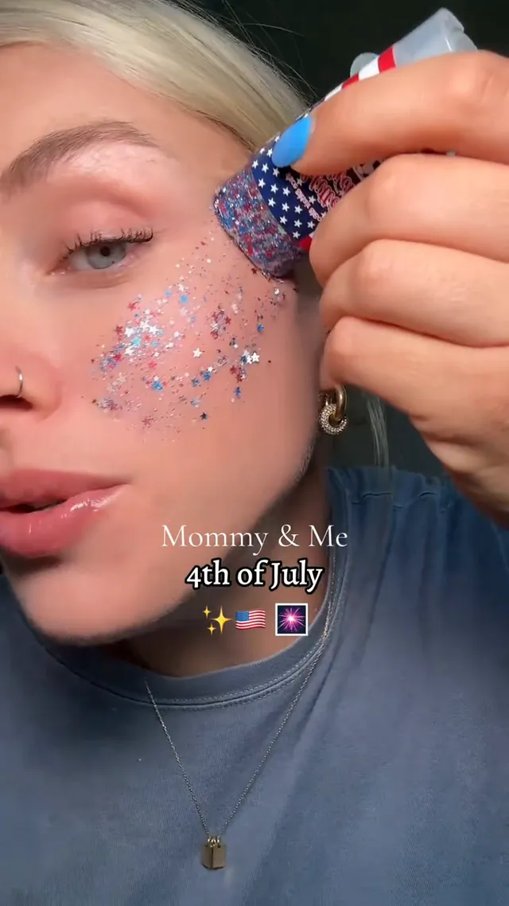
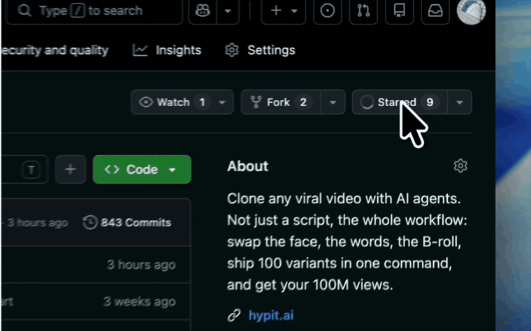

<h1 align="center">Clipcat: The First — and Only — Skill Built to Replicate Winning Shoppable Videos</h1>

<p align="center"><strong>Discover, replicate, and scale winning TikTok Shop videos — built to help sellers and creators unlock 10× growth.</strong></p>

<p align="center"></p>

<p align="center"><a href="#quick-start">Quick start</a> · <a href="#examples">5 real-world examples</a> · <a href="skills/clipcat/SKILL.md">Command reference</a> · <a href="https://clipcat.ai">Website</a> · <a href="README_ZH.md">简体中文</a></p>

<p align="center">
  <a href="https://github.com/Clipcat-ai/clipcat-skill"></a>
  <a href="skills/clipcat/SKILL.md"></a>
</p>

Clipcat is the first Agent Skill dedicated to replicating winning ecommerce videos. It closes the loop from discovering proven formats → creating new winners through replication or product-to-video → publishing → analyzing performance and iterating. Turn Codex, WorkBuddy, Claude, OpenClaw, and other agents into capable TikTok Shop operators — and grow your TikTok business with far less manual work.

## Why Clipcat

Four core capabilities — from finding proven inspiration to creating, publishing, and iterating on winning videos.

<table>
<tr>
<td width="50%" valign="top"><p><strong>AI Shoppable Video & Prompt Library</strong><br />The world’s largest free library of AI shoppable videos and prompts, covering high-selling TikTok winners across every market and category. Copy a prompt or replicate the whole format in one click.</p></td>
<td width="50%" valign="top"><p><strong>Professional Viral Replication</strong><br />Replicate winning selling videos from a TikTok or Douyin link, a direct URL, or a local video. Clipcat breaks down the original logic and script, then rebuilds the format around your product.</p></td>
</tr>
<tr>
<td width="50%" valign="top"><p><strong>Consistent Characters Across Videos</strong><br />Use the same character reference in viral replication or product-to-video workflows, so the on-screen character can stay consistent across a content series.</p></td>
<td width="50%" valign="top"><p><strong>Publish to TikTok in One Click</strong><br />Connect and manage multiple TikTok accounts in one place. Publish now, schedule ahead, or send a video to drafts — flexible publishing that helps automate your content workflow.</p></td>
</tr>
</table>

## Quick start

You need an AI agent that can run shell commands and a Clipcat account with an API key.

### 1. Install the Clipcat CLI

macOS / Linux / Git Bash:

```bash
curl -fsSL https://clipcat.ai/cli | bash
```

Windows PowerShell:

```powershell
irm https://clipcat.ai/cli.ps1 | iex
```

### 2. Create and configure your API key

[Get your API key in Clipcat](https://clipcat.ai/workspace?modal=settings&tab=apikeys), then send this command to your agent:

```bash
clipcat config --api-key YOUR_API_KEY --base-url https://clipcat.ai
```

Replace `YOUR_API_KEY` with your own key, then send the complete command to your agent.

## Examples

All five examples come from the Clipcat × Codex tutorial. Each follows the same structure: real conversation → playable result → prompt and notes.

### 1. Viral Replication: Turn a TikTok Reference into Your Product Video

Found a strong reference? Give your agent the TikTok link and product photos. Clipcat reconstructs the script and shot logic around your product.

<table><tr>
<td width="50%" valign="top"></td>
<td width="50%" valign="top"></td>
</tr></table>

<table><tr>
<td width="50%" valign="top"></td>
<td width="50%" valign="top"></td>
</tr></table>

| Original reference — click to play | Replicated product video — click to play |
|---|---|
| https://github.com/user-attachments/assets/5f8f5d3d-42d0-4a9e-a27d-cda0ce9ddfe1 | https://github.com/user-attachments/assets/6e548385-acf1-4f06-b0c5-b8a93f498d1a |

<table><tr><td valign="top"><details open><summary><strong>Copy-ready prompt</strong></summary>

```text
Use the Clipcat Skill to create a product-specific version of this proven reference.
TikTok reference: {COMPLETE_VIDEO_URL}
My product photos: {PRODUCT_IMAGES_OR_PATHS}
Keep the original hook, shot order, and pacing, but replace the product with mine.
Adapt any existing voiceover to my product. If there is none, do not add one. No subtitles.
Duration: {SECONDS}; model: {MODEL_ID}; voiceover language: {LANGUAGE}.
Show the full prompt, settings, and credit cost. Wait for my approval.
```

</details></td><td width="36%" valign="top"><strong>Notes</strong><p>Preserve the proven hook and shot logic while adapting the product, claims, and voiceover.</p><p><a href="https://clipcat.ai/en/blog/codex-tiktok-shopping-video-tutorial">Read the full tutorial</a></p></td></tr></table>

### 2. Product-to-Video: Create Native, High-Converting UGC

Upload product photos and a brief to create native-feeling demos, talking-head explainers, OOTD clips, reviews, and other TikTok Shop UGC.

<table><tr>
<td width="50%" valign="top"></td>
<td width="50%" valign="top"></td>
</tr></table>

<p align="center"></p>

**Generated result — click to play**

https://github.com/user-attachments/assets/d90b1d54-6168-404e-908d-699420dd0563

<table><tr><td valign="top"><details open><summary><strong>Copy-ready prompt</strong></summary>

```text
Use the Clipcat Skill to create a selling video from my product photos.
Product photos: {PRODUCT_IMAGES_OR_PATHS}
Creative brief: {PRESENTER, SETTING, DEMO ACTIONS, AND SELLING_POINTS}
Market: {MARKET}; duration: {SECONDS}; aspect ratio: {9:16 OR 16:9}.
Model: {MODEL_ID}; voiceover language: {LANGUAGE}.
Use only the claims I provide. Show the prompt and credit cost before generating.
```

</details></td><td width="36%" valign="top"><strong>Notes</strong><p>Clear product facts, presenter direction, setting, demo actions, and selling points lead to more reliable outputs.</p><p><a href="https://clipcat.ai/en/blog/codex-tiktok-shopping-video-tutorial">Read the full tutorial</a></p></td></tr></table>

### 3. Discover a TikTok Winner, Then Replicate the Format

Connect discovery, selection, structural analysis, and replication in one workflow.

<table><tr>
<td width="50%" valign="top"></td>
<td width="50%" valign="top"></td>
</tr></table>

<p align="center"></p>

**Generated result — click to play**

https://github.com/user-attachments/assets/a5f6c5be-1ee1-4627-95ed-93028f866e5e

<table><tr><td valign="top"><details open><summary><strong>Copy-ready prompt</strong></summary>

```text
Use the Clipcat Skill to find popular selling videos for {PRODUCT_CATEGORY} in {TARGET_MARKET} from the last 7 days.
My product photos: {PRODUCT_IMAGES_OR_PATHS}
Explain query costs first. Show sources and available metrics, then select the best-fit reference.
Use its hook and pacing; adapt the product and voiceover to mine. No subtitles.
Duration: {SECONDS}; model: {MODEL_ID}; voiceover language: {LANGUAGE}.
Show the reference URL, full prompt, and generation cost. Wait for approval.
```

</details></td><td width="36%" valign="top"><strong>Notes</strong><p>Keep the sources and available metrics. Choose a relevant reference without treating historical performance as a promise.</p><p><a href="https://clipcat.ai/en/blog/codex-tiktok-shopping-video-tutorial">Read the full tutorial</a></p></td></tr></table>

### 4. Generate Selling Videos with a Consistent Character

Use a saved character reference or accessible portrait so a series can retain the same on-screen identity.

<table><tr>
<td width="50%" valign="top"></td>
<td width="50%" valign="top"></td>
</tr></table>

<p align="center"></p>

**Generated result — click to play**

https://github.com/user-attachments/assets/28b3f3a0-8f55-42ab-96d5-0e3a724b3cd3

<table><tr><td valign="top"><details open><summary><strong>Copy-ready prompt</strong></summary>

```text
Use the Clipcat Skill to make a product video with my saved character.
Character: {AVAILABLE_CHARACTER_ID_OR_CHARACTER_IMAGE_URL}
Product photos: {PRODUCT_IMAGES_OR_PATHS}; TikTok reference: {COMPLETE_VIDEO_URL}
Keep the reference structure and pacing; adapt the product and voiceover to mine.
If the reference has an on-screen presenter, use my character reference. No subtitles.
Duration: {SECONDS}; model: {MODEL_ID_WITH_CHARACTER_SUPPORT}; voiceover: {LANGUAGE}.
Check character availability, show the settings and cost, and wait for approval.
```

</details></td><td width="36%" valign="top"><strong>Notes</strong><p>Character references guide series consistency; results still depend on the model and source assets.</p><p><a href="https://clipcat.ai/en/blog/codex-tiktok-shopping-video-tutorial">Read the full tutorial</a></p></td></tr></table>

### 5. Daily Automation: Keep New Winning Creatives Coming

Set up the workflow once to discover references, deduplicate them, generate outputs, log results, and send new creatives for review.

<table><tr>
<td width="25%" valign="top"></td>
<td width="25%" valign="top"></td>
<td width="25%" valign="top"></td>
<td width="25%" valign="top"></td>
</tr></table>

<p align="center"></p>

**Generated result — click to play**

https://github.com/user-attachments/assets/a5e0bb94-60bf-4cbc-bb00-f11efb237f7b

<table><tr><td valign="top"><details open><summary><strong>Copy-ready prompt</strong></summary>

```text
Set up a recurring Agent task with the Clipcat Skill to keep new selling creatives coming.
Time: {DAILY_TIME}; timezone: {IANA_TIMEZONE}; market: {TARGET_MARKET}.
Category: {KEYWORDS}; product photos: {PERSISTENT_ASSET_REFERENCES}.
Find relevant videos from the last 7 days and deduplicate them against saved reference history.
Choose a reference, replace the product, and adapt the voiceover to my verified claims.
No subtitles. Duration: {SECONDS}; model: {MODEL_ID}; voiceover: {LANGUAGE}; per-run limit: {BUDGET}.
Confirm schedule, timezone, assets, budget, and unattended-generation authorization first. Do not auto-publish.
```

</details></td><td width="36%" valign="top"><strong>Notes</strong><p>Automation needs persistent assets, deduplication history, a budget, and prior authorization. Automated generation is not automatic publishing.</p><p><a href="https://clipcat.ai/en/blog/codex-tiktok-shopping-video-tutorial">Read the full tutorial</a></p></td></tr></table>

## Capabilities at a Glance

1. **Replicate Proven Winners:** Paste a TikTok link and turn a validated winning format into new revenue opportunities by rebuilding it around your product.
2. **Product-to-Video:** Upload product photos and a creative brief to generate realistic UGC — product explainers, OOTD clips, reviews, demos, and character-consistent content.
3. **Video Search:** Search popular TikTok videos by keyword and retrieve the videos with available performance data.
4. **Video Analysis:** Submit a TikTok or Douyin video to extract its voiceover script and scene-by-scene visuals, giving you the full content structure quickly.
5. **Video Download:** Download high-quality, watermark-free TikTok and Douyin videos.
6. **Product & Category Search:** Search relevant products by keyword or category.
7. **Product Details:** Use a product ID and market to retrieve TikTok Shop product details, including basic information, images, sales, pricing, seller, and fulfillment data.
8. **Product Reviews:** Use a product ID and market to retrieve TikTok Shop customer reviews.
9. **AI Product Images:** Generate ecommerce-ready product and lifestyle images with GPT Image 2.5 / 2.0.
10. **Account Analytics:** Enter a TikTok account to retrieve its videos and related data, including views, likes, content, and comments.
11. **TikTok Publishing:** Authorize a TikTok account in Clipcat once, then publish videos to TikTok in one click.

## AI Shoppable Video Prompt Library

We also provide free access to the world’s largest library of AI shoppable videos and prompts.

It collects high-selling TikTok Shop videos across every active market and major category. Prompts are free to search and copy, and any matching format can be replicated with one click. Every prompt is reverse-engineered from a real TikTok Shop selling video — not written from scratch — and reconstructed shot by shot. Each entry includes the original video, so you can verify the structure directly.

We have published part of the Clipcat video and prompt library as Markdown in our [GitHub Prompt Library](https://github.com/Clipcat-ai/awesome-tiktok-shop-video-prompts/tree/main), making it easy to browse, search, and reuse. The complete library contains **30,000+ videos across 15 markets and 30 categories**, with new winners added daily. Our goal is simple: help more people create high-performing shoppable videos from real, verifiable references.

**After installing the Clipcat Skill, try:**

```text
Search Clipcat’s prompt library for winning videos that match my product {PRODUCT_NAME_OR_DESCRIPTION}, then generate an adapted prompt for my product.
```

## Models, Credits, and Control

New users receive starter credits to explore Clipcat’s full workflow. Continue using the product by purchasing additional credits when needed.

Video and image generation, plus video and product queries, consume credits according to the task. Clipcat gives you one-click access to leading video models, including **Seedance 2.5, Seedance 2.0, MiniMax H3, Wan 3.0, Omni, Veo 3.1, and Grok Imagine 1.5**.

Before a video task is created, your agent confirms the requirements and credit cost with you. TikTok account authorization is required only once; future publishing does not require repeated authorization, and Clipcat supports multi-account management and publishing.

## Follow Clipcat

Give us a Star and be the first to hear about every new GitHub release!

<p align="center"><a href="https://github.com/Clipcat-ai/clipcat-skill"></a></p>
