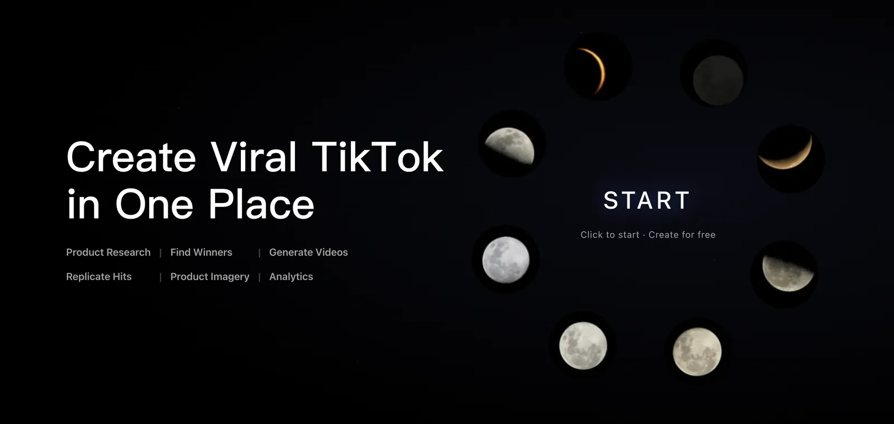
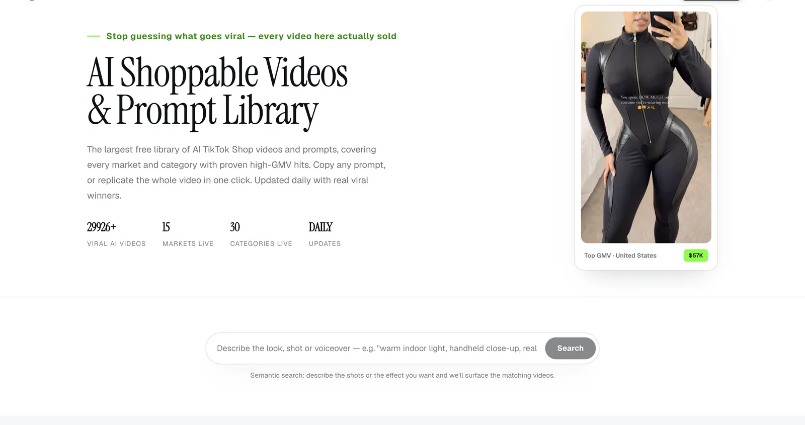
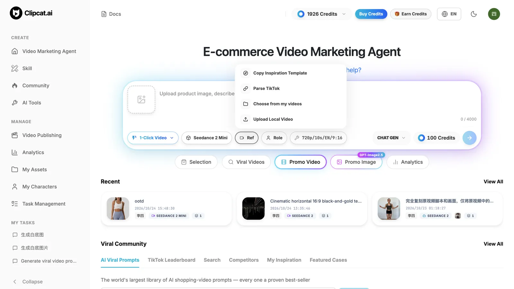
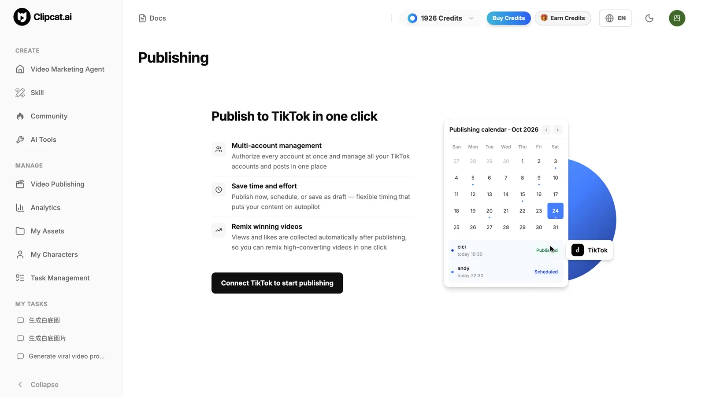
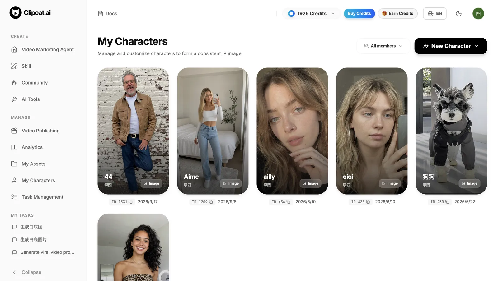
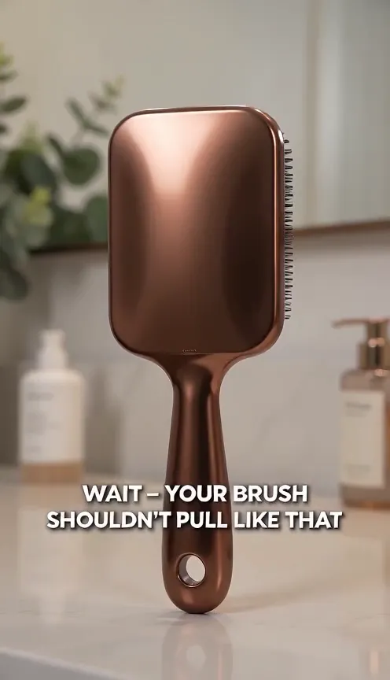
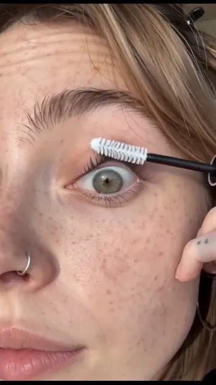

<h1 align="center">Clipcat Skill — Your AI Agent, Now a TikTok Shop Video Producer</h1>

<p align="center"><strong>Find the format. Make it yours. Let your agent do the production.</strong></p>

<p align="center"></p>

<p align="center"><a href="#quick-start">Quick start</a> · <a href="#demo">5 real-world demos</a> · <a href="skills/clipcat/SKILL.md">Command reference</a> · <a href="https://clipcat.ai">Website</a> · <a href="README_ZH.md">简体中文</a></p>

<p align="center">
  <a href="https://github.com/Clipcat-ai/clipcat-skill"></a>
  <a href="skills/clipcat/SKILL.md"></a>
  <a href="#demo"></a>
</p>

A product photo, a reference video, or a creative brief. Connect discovery, replication, generation, and approved publishing with Clipcat.

> **Star Clipcat now.** Keep it ready for your next launch and help other creators discover the project.

## Why Clipcat

Four core capabilities — from finding winners to creating and publishing consistently.

<table>
<tr>
<td width="50%" valign="top">

<p><strong>AI Shoppable Video & Prompt Library</strong><br />The world’s largest free library of AI shoppable videos and prompts, covering high-selling TikTok winners across every market and category. Copy a prompt or replicate the whole format in one click.</p>
</td>
<td width="50%" valign="top">

<p><strong>Professional Viral Replication</strong><br />Replicate winning selling videos from a TikTok or Douyin link, a direct URL, or a local video. Clipcat breaks down the original logic and script, then rebuilds the format around your product.</p>
</td>
</tr>
<tr>
<td width="50%" valign="top">

<p><strong>Publish to TikTok in One Click</strong><br />Connect and manage multiple TikTok accounts in one place. Publish now, schedule ahead, or send a video to drafts — flexible publishing that helps automate your content workflow.</p>
</td>
<td width="50%" valign="top">

<p><strong>Consistent Characters Across Videos</strong><br />Use the same character reference in viral replication or product-to-video workflows, so the on-screen character can stay consistent across a content series.</p>
</td>
</tr>
</table>

## Quick start

You need an AI agent that can run shell commands and a Clipcat account with an API key. Installing the Skill does not make generation or data queries free.

### 1. Add the Skill to your agent

```bash
npx skills add Clipcat-ai/clipcat-skill -g --skill clipcat
```

Select your agent when prompted. On first use, the Skill guides the agent to check for the CLI and install it if missing.

<details>
<summary>Manual CLI setup</summary>

macOS / Linux / Git Bash:

```bash
curl -fsSL https://clipcat.ai/cli | bash
```

Windows PowerShell:

```powershell
irm https://clipcat.ai/cli.ps1 | iex
```

</details>

### 2. Create and configure your API key

[Get your API key in Clipcat](https://clipcat.ai/workspace?modal=settings&tab=apikeys), then configure it:

```bash
clipcat config --api-key YOUR_API_KEY --base-url https://clipcat.ai
```

Replace `YOUR_API_KEY` with your key. Do not commit it or include it in screenshots, prompts, or issues.

### 3. Pick a demo and make it yours

Pick one of the [five demos below](#demo), attach your product photos, and expand its copy-ready prompt.

## Demo

These five use cases come from the [Clipcat × Codex tutorial](https://clipcat.ai/en/blog/codex-tiktok-shopping-video-tutorial). Images and videos are stored in `assets/`. Click a cover to play the repository video, then expand the prompt to adapt it.

Use `clipcat models` for current models and pricing; historical tutorial settings are not a live quote.

### 1. Viral Replication — Make the Reference Your Product Video

Give your agent a TikTok link and product photos. Adapt the original hook and shot structure, rewrite the voiceover, and create a version for your product.

<p align="center"><a href="assets/demo-01-replication-en.mp4"></a></p>

<p align="center"><a href="assets/demo-01-replication-en.mp4"><strong>▶ Play demo video</strong></a> · <a href="https://clipcat.ai/en/blog/codex-tiktok-shopping-video-tutorial">Full tutorial</a></p>

<details>
<summary>Copy the prompt for this workflow</summary>

```text
Use the Clipcat Skill to create a product-specific version of this reference.
TikTok reference: {COMPLETE_VIDEO_URL}
My product photos: {PRODUCT_IMAGES_OR_PATHS}
Use the original hook, shot order, and pacing; replace the product with mine.
Adapt any existing voiceover to my product. If there is none, do not add it. No subtitles.
Duration: {SECONDS}; model: {MODEL_ID}; voiceover language: {LANGUAGE}.
Show the full prompt, settings, and credit cost. Wait for my approval.
```

</details>

### 2. Product-to-Video — Start with a Photo

Turn product photos and a creative brief into an on-camera demo, UGC-style video, or talking-head selling clip.

<p align="center"><a href="assets/demo-02-product-to-video-en.mp4"></a></p>

<p align="center"><a href="assets/demo-02-product-to-video-en.mp4"><strong>▶ Play demo video</strong></a> · <a href="https://clipcat.ai/en/blog/codex-tiktok-shopping-video-tutorial">Full tutorial</a></p>

<details>
<summary>Copy the prompt for this workflow</summary>

```text
Use the Clipcat Skill to create a selling video from my product photos.
Product photos: {PRODUCT_IMAGES_OR_PATHS}
Creative brief: {PRESENTER, SETTING, DEMO ACTIONS, AND SELLING_POINTS}
Market: {MARKET}; duration: {SECONDS}; aspect ratio: {9:16 OR 16:9}.
Model: {MODEL_ID}; voiceover language: {LANGUAGE}.
Use only the claims I provide. Show the prompt and credit cost before generating.
```

</details>

### 3. Discover and Replicate — From Inspiration to Output

Find recent selling-video references, select a relevant winner, analyze the structure, and create a new version with your product.

<p align="center"><a href="assets/demo-03-discover-replicate-en.mp4"></a></p>

<p align="center"><a href="assets/demo-03-discover-replicate-en.mp4"><strong>▶ Play demo video</strong></a> · <a href="https://clipcat.ai/en/blog/codex-tiktok-shopping-video-tutorial">Full tutorial</a></p>

<details>
<summary>Copy the prompt for this workflow</summary>

```text
Use the Clipcat Skill to find popular selling videos for {PRODUCT_CATEGORY} in {TARGET_MARKET} from the last 7 days.
My product photos: {PRODUCT_IMAGES_OR_PATHS}
Explain query costs first. Show sources and available metrics, then select a relevant reference.
Use its hook and pacing; adapt the product and voiceover to mine. No subtitles.
Duration: {SECONDS}; model: {MODEL_ID}; voiceover language: {LANGUAGE}.
Show the reference URL, full prompt, and generation cost. Wait for approval.
```

</details>

### 4. Consistent Characters — Build a Recognizable Series

Pair a saved character reference with product images so a content series can keep a consistent on-screen identity.

<p align="center"><a href="assets/demo-04-consistent-character-en.mp4"></a></p>

<p align="center"><a href="assets/demo-04-consistent-character-en.mp4"><strong>▶ Play demo video</strong></a> · <a href="https://clipcat.ai/en/blog/codex-tiktok-shopping-video-tutorial">Full tutorial</a></p>

<details>
<summary>Copy the prompt for this workflow</summary>

```text
Use the Clipcat Skill to make a product video with my saved character.
Character: {AVAILABLE_CHARACTER_ID_OR_CHARACTER_IMAGE_URL}
Product photos: {PRODUCT_IMAGES_OR_PATHS}; TikTok reference: {COMPLETE_VIDEO_URL}
Use the reference structure and pacing; adapt the product and voiceover to mine.
If the reference has an on-screen presenter, use my character reference. No subtitles.
Duration: {SECONDS}; model: {MODEL_ID_WITH_CHARACTER_SUPPORT}; voiceover: {LANGUAGE}.
Check character availability, show the settings and cost, and wait for approval.
```

</details>

### 5. Daily Automation — Keep New Creatives Coming

Use a scheduled workflow to discover references, deduplicate them, generate outputs, and log results for review.

<p align="center"><a href="assets/demo-05-daily-automation-en.mp4"></a></p>

<p align="center"><a href="assets/demo-05-daily-automation-en.mp4"><strong>▶ Play demo video</strong></a> · <a href="https://clipcat.ai/en/blog/codex-tiktok-shopping-video-tutorial">Full tutorial</a></p>

<details>
<summary>Copy the prompt for this workflow</summary>

```text
Set up a recurring Agent task using the Clipcat Skill to prepare selling videos.
Time: {DAILY_TIME}; timezone: {IANA_TIMEZONE}; market: {TARGET_MARKET}.
Category: {KEYWORDS}; product photos: {PERSISTENT_ASSET_REFERENCES}.
Find relevant videos from the last 7 days and deduplicate against saved reference history.
Choose a reference, replace the product, and adapt the voiceover to my verified claims.
No subtitles. Duration: {SECONDS}; model: {MODEL_ID}; voiceover: {LANGUAGE}; per-run limit: {BUDGET}.
Confirm schedule, timezone, assets, budget, and unattended-generation authorization first. Do not auto-publish.
```

</details>

Automation needs persistent assets, history, an explicit budget, and prior authorization. Automated generation is not automatic publishing.

> **Found a demo you would use? Star this repo now and keep Clipcat in your toolkit.**

## What you can do

- Selling-video and product research
- Source-linked prompt discovery
- TikTok and Douyin video analysis
- Product-to-video and viral replication
- AI images, reusable characters, and enhancement
- TikTok direct posts, scheduled posts, and drafts
- TikTok and Douyin video downloads

For current commands, models, and pricing:

```bash
clipcat models
```

## Models, credits, and control

Video and image generation, video tools, and data queries may consume credits. Interactive video tasks first show the model, prompt, and cost, then wait for approval. TikTok publishing separately confirms the account, caption, visibility, and schedule. Past views, sales, or GMV are context — not a promise for a new video.

## Help improve Clipcat

Found a confusing command or a workflow worth sharing? [Open an issue](https://github.com/Clipcat-ai/clipcat-skill/issues). Remove API keys and private account details before sharing logs.

## Star Clipcat. Help more creators find it.

**If Clipcat helped you find a selling angle or create a product video, click Star at the top right now.** It helps you find Clipcat again and helps more sellers, creators, and agent builders discover the project.

[ **Open the repo and Star Clipcat** ](https://github.com/Clipcat-ai/clipcat-skill)

Use GitHub **Watch** for update notifications. A Star is a bookmark and signal of appreciation, not a notification subscription.
