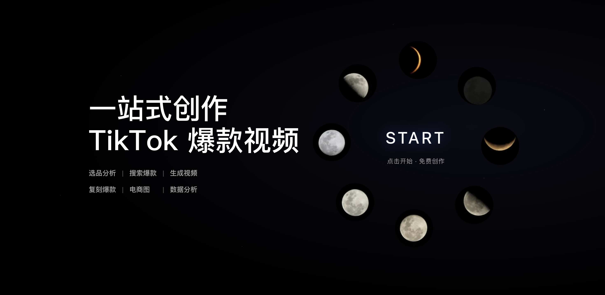
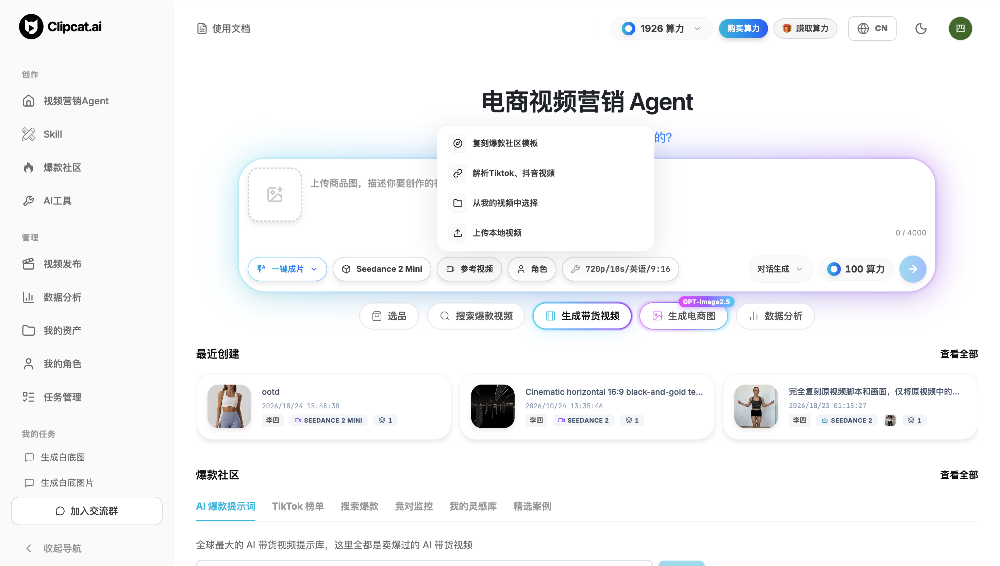
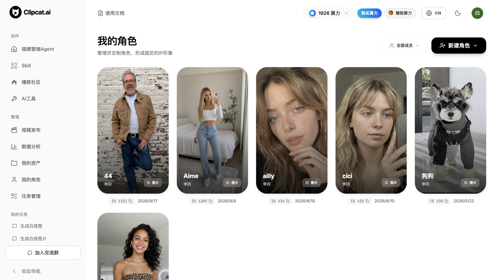
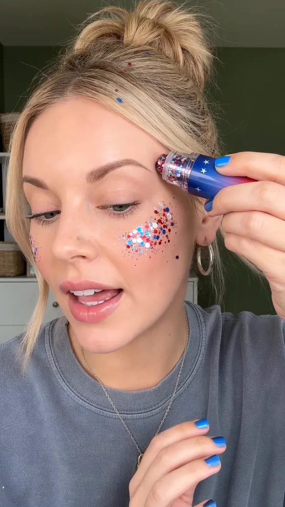
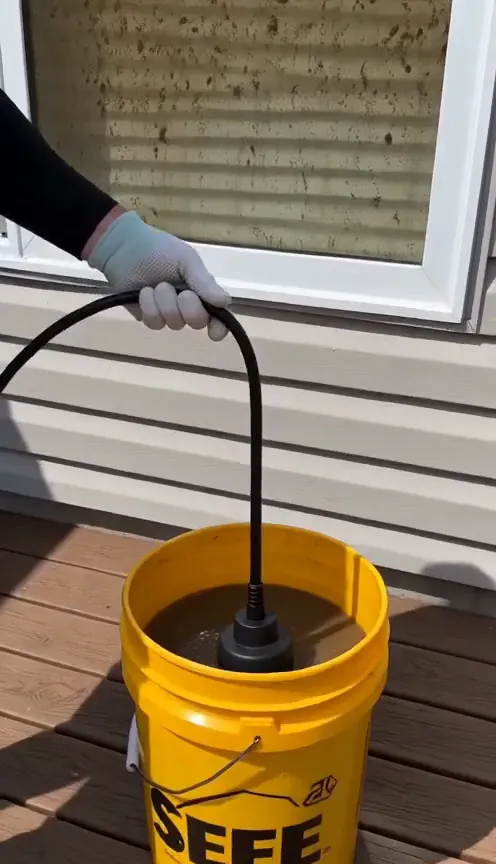

<h1 align="center">Clipcat Skill — 把你的 AI Agent 变成 TikTok 带货视频制作人</h1>

<p align="center"><strong>找到爆款灵感，换上你的商品，让 Agent 帮你出片。</strong></p>

<p align="center"></p>

<p align="center"><a href="#快速开始">快速开始</a> · <a href="#demo">5 个实战 Demo</a> · <a href="skills/clipcat/SKILL.md">命令参考</a> · <a href="https://clipcat.ai">官网</a> · <a href="README.md">English</a></p>

<p align="center">
  <a href="https://github.com/Clipcat-ai/clipcat-skill"></a>
  <a href="skills/clipcat/SKILL.md"></a>
  <a href="#demo"></a>
</p>

一张商品图，一条参考视频，或一句创意。用 Clipcat 把找灵感、复刻、生成和审核发布衔接起来。

> **现在给 Clipcat 点个 Star。** 收藏下来，下次上新就能找到，也让更多创作者看见这个项目。

## 为什么用 Clipcat

四个核心能力，从找爆款到稳定出片与发布。

<table>
<tr>
<td width="50%" valign="top">

<p><strong>AI 带货视频与提示词库</strong><br />全球最大的免费 AI 带货视频与提示词库，涵盖 TikTok 所有国家与品类的高销量爆款。提示词可复制，也能一键复刻生成同款。</p>
</td>
<td width="50%" valign="top">

<p><strong>专业爆款复刻</strong><br />一键爆款复刻带货视频，支持 TikTok、抖音链接和本地视频。解析原视频爆款逻辑和脚本，结合你的产品一键生成同款带货视频。</p>
</td>
</tr>
<tr>
<td width="50%" valign="top">

<p><strong>直连 TikTok 一键发布</strong><br />多账号管理，一站式管理全部 TikTok 账号和视频发布。支持立即发布、定时发布与草稿，灵活排期，自动化你的视频内容。</p>
</td>
<td width="50%" valign="top">

<p><strong>固定角色持续出镜</strong><br />无论爆款复刻还是商品图生视频，都能使用固定角色参考，让系列视频中的角色人物保持一致。</p>
</td>
</tr>
</table>

## 快速开始

你需要一个能执行 shell 命令的 AI Agent，以及 Clipcat 账号和 API Key。安装 Skill 不代表生成与数据查询免费。

### 1. 给 Agent 安装 Skill

```bash
npx skills add Clipcat-ai/clipcat-skill -g --skill clipcat
```

按提示选择使用的 Agent。首次使用时，Skill 会引导 Agent 检查 CLI，缺失时再安装。

<details>
<summary>手动配置 CLI</summary>

macOS / Linux / Git Bash:

```bash
curl -fsSL https://clipcat.ai/cli | bash
```

Windows PowerShell:

```powershell
irm https://clipcat.ai/cli.ps1 | iex
```

</details>

### 2. 获取并配置 API Key

[在 Clipcat 中生成 API Key](https://clipcat.ai/workspace?modal=settings&tab=apikeys)，然后配置：

```bash
clipcat config --api-key YOUR_API_KEY --base-url https://clipcat.ai
```

将 `YOUR_API_KEY` 替换成自己的密钥。不要提交到仓库、截图、提示词或 Issue。

### 3. 选一个 Demo，换成你的商品

从[下面五个 Demo](#demo)选择场景，上传商品图，再展开对应提示词。

## Demo

五个用例来自 [Clipcat × Codex 实战教程](https://clipcat.ai/zh/blog/codex-tiktok-shopping-video-tutorial). 图片和视频已下载到仓库 `assets/`。点击封面播放仓库内视频，展开提示词改成你的商品。

模型与价格以 `clipcat models` 为准，博客截图中的历史参数不作为当前报价。

### 1. 爆款复刻：把参考视频变成你的商品视频

把 TikTok 链接和商品图交给 Agent，参考原片的钩子与分镜，改写口播并生成你的商品版本。

<p align="center"><a href="assets/demo-01-replication-zh.mp4"></a></p>

<p align="center"><a href="assets/demo-01-replication-zh.mp4"><strong>▶ 播放 Demo 视频</strong></a> · <a href="https://clipcat.ai/zh/blog/codex-tiktok-shopping-video-tutorial">完整教程</a></p>

<details>
<summary>复制这个场景的提示词</summary>

```text
使用 Clipcat Skill 的复刻功能。
参考 TikTok 链接：{完整视频链接}
我的商品图：{商品图片或路径}
参考原片的钩子、镜头顺序和画面节奏，只将商品改为我的商品。
原片有口播时，按我的商品卖点改写；没有口播则不添加。不要字幕。
时长：{目标秒数}；模型：{模型 ID}；口播语言：{语言}。
先展示完整提示词、生成参数和算力费用，等我确认后再生成。
```

</details>

### 2. 商品图生视频：一张图，开拍你的带货创意

输入商品图和生成要求，生成真人演示、UGC 或口播风格的 TikTok 带货视频。

<p align="center"><a href="assets/demo-02-product-to-video-zh.mp4"></a></p>

<p align="center"><a href="assets/demo-02-product-to-video-zh.mp4"><strong>▶ 播放 Demo 视频</strong></a> · <a href="https://clipcat.ai/zh/blog/codex-tiktok-shopping-video-tutorial">完整教程</a></p>

<details>
<summary>复制这个场景的提示词</summary>

```text
使用 Clipcat Skill，根据我的商品图生成带货视频。
商品图：{商品图片或路径}
创意要求：{人物、场景、演示动作和商品卖点}
目标市场：{市场}；时长：{目标秒数}；比例：{9:16 或 16:9}。
模型：{模型 ID}；口播语言：{语言}。
只使用我提供的真实卖点，先展示提示词和算力费用，确认后再生成。
```

</details>

### 3. AI 找爆款再复刻：从灵感到成片

先找近期相关爆款，筛选参考、分析结构，再把商品替换成你的产品生成新版本。

<p align="center"><a href="assets/demo-03-discover-replicate-zh.mp4"></a></p>

<p align="center"><a href="assets/demo-03-discover-replicate-zh.mp4"><strong>▶ 播放 Demo 视频</strong></a> · <a href="https://clipcat.ai/zh/blog/codex-tiktok-shopping-video-tutorial">完整教程</a></p>

<details>
<summary>复制这个场景的提示词</summary>

```text
使用 Clipcat Skill，寻找 {目标市场} 近 7 天与 {商品品类} 相关的热门带货视频。
我的商品图：{商品图片或路径}
先说明查询费用，展示来源和可取得的指标，并挑选最适合我的商品的参考。
参考它的钩子和分镜节奏，将商品与口播改写为我的内容，不要字幕。
时长：{目标秒数}；模型：{模型 ID}；口播语言：{语言}。
展示参考链接、完整提示词和生成费用，等我确认。
```

</details>

### 4. 固定角色出镜：建立统一账号人设

指定可用角色参考与商品图，让系列带货视频使用统一的角色形象。

<p align="center"><a href="assets/demo-04-consistent-character-zh.mp4"></a></p>

<p align="center"><a href="assets/demo-04-consistent-character-zh.mp4"><strong>▶ 播放 Demo 视频</strong></a> · <a href="https://clipcat.ai/zh/blog/codex-tiktok-shopping-video-tutorial">完整教程</a></p>

<details>
<summary>复制这个场景的提示词</summary>

```text
使用 Clipcat Skill，为我的商品制作固定角色出镜视频。
出镜角色：{已保存且可用的角色 ID 或角色图片链接}
商品图：{商品图片或路径}；参考 TikTok 链接：{完整视频链接}
参考原片的脚本结构和节奏，商品与口播改写为我的内容。
原片有人物出镜时，新片使用我的角色参考；不要字幕。
时长：{目标秒数}；模型：{支持角色参考的模型 ID}；口播语言：{语言}。
先核对角色可用性，展示完整参数和费用，等我确认后生成。
```

</details>

### 5. 每日自动化：持续准备新素材

用定时任务持续寻找参考、去重、生成并记录结果，让你从反复做素材转向审核素材。

<p align="center"><a href="assets/demo-05-daily-automation-zh.mp4"></a></p>

<p align="center"><a href="assets/demo-05-daily-automation-zh.mp4"><strong>▶ 播放 Demo 视频</strong></a> · <a href="https://clipcat.ai/zh/blog/codex-tiktok-shopping-video-tutorial">完整教程</a></p>

<details>
<summary>复制这个场景的提示词</summary>

```text
为我设置一个 Agent 定时任务，使用 Clipcat Skill 持续准备带货视频。
时间：{每日时间}；时区：{IANA 时区}；市场：{目标市场}。
商品品类：{关键词}；商品图：{可持续访问的素材引用}。
寻找近 7 天相关带货视频，与历史参考记录去重，再挑选适合我的参考。
生成时替换成我的商品，按真实卖点改写口播，不要字幕。
时长：{目标秒数}；模型：{模型 ID}；口播语言：{语言}；单次费用上限：{预算}。
创建前确认时间、时区、素材、预算和自动生成授权；不要自动发布。
```

</details>

自动化需要持久化素材、历史记录、明确预算与预先授权；自动生成不等于自动发布。

> **这些 Demo 有一个能帮到你？现在点个 Star，把 Clipcat 留在你的工具箱里。**

## 还能做什么

- 带货视频与商品数据调研
- 带来源的提示词检索
- TikTok / 抖音视频分析
- 商品图生视频与爆款复刻
- AI 图片、角色复用与视频超分
- TikTok 立即发布、定时发布和草稿
- TikTok / 抖音视频下载

完整命令、实时模型与价格：

```bash
clipcat models
```

## 模型、费用与控制

视频和图片生成、视频工具及数据查询可能消耗算力。交互式视频任务会先展示模型、提示词和费用，等你确认后才创建。发布 TikTok 需要单独确认账号、文案、可见范围和排期。历史播放、销量或 GMV 是参考，不是新视频的效果承诺。

## 一起把 Clipcat 做得更好

遇到问题或有工作流案例？[提交 Issue](https://github.com/Clipcat-ai/clipcat-skill/issues)。分享日志前请移除 API Key 与账号私密信息。

## 用一个 Star，支持更多这样的工作流

**如果 Clipcat 帮你找到带货角度或做出商品视频，现在就在 GitHub 右上角点 Star。** 它方便你下次找到 Clipcat，也让更多商家、创作者和 Agent 开发者发现这个项目。

[ **打开仓库，给 Clipcat Star** ](https://github.com/Clipcat-ai/clipcat-skill)

需要更新通知时，请使用 GitHub **Watch**；Star 用于收藏与表达认可，不等同于订阅通知。
