<h1 align="center">Clipcat：首个带货视频爆款复刻，不是之一，是唯一。</h1>

<p align="center"><strong>发现、复刻和裂变 TikTok 爆款带货视频，助力商家、达人带来 10X 增长。</strong></p>

<p align="center"></p>

<p align="center"><a href="#快速开始">快速开始</a> · <a href="#示例">5 个实战示例</a> · <a href="skills/clipcat/SKILL.md">命令参考</a> · <a href="https://clipcat.ai">官网</a> · <a href="README.md">English</a></p>

<p align="center">
  <a href="https://github.com/Clipcat-ai/clipcat-skill"></a>
  <a href="skills/clipcat/SKILL.md"></a>
</p>

Clipcat 是首个专注电商带货方向的爆款复刻 Skill。从发现爆款 → 生成爆款视频（爆款复刻 / 商品生视频）→ 发布视频 → 数据分析迭代爆款，形成完整增长闭环。让你的 Codex、WorkBuddy、Claude、OpenClaw 等 Agent 变身专业 TikTok 操盘手，助力 TikTok 业务高效增长。

## 为什么用 Clipcat

四个核心能力，从找爆款灵感到做爆款视频和发布迭代。

<table>
<tr>
<td width="50%" valign="top">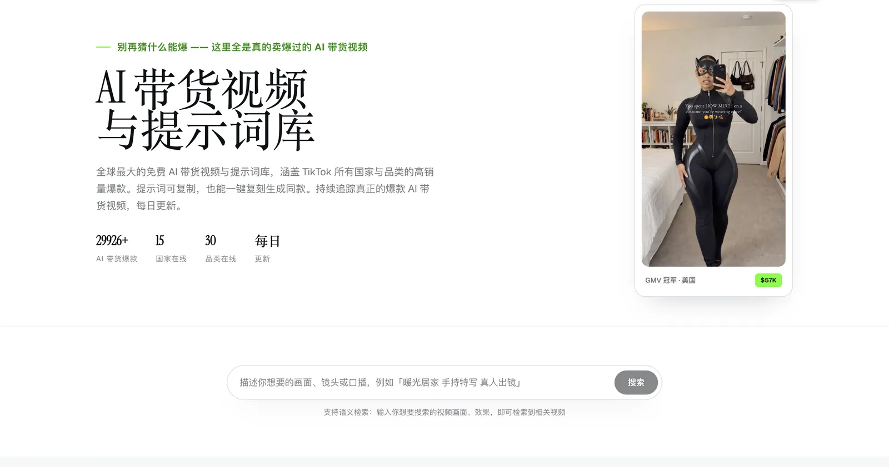<p><strong>AI 带货视频与提示词库</strong><br />全球最大的免费 AI 带货视频与提示词库，涵盖 TikTok 所有国家与品类的高销量爆款。提示词可复制，也能一键复刻生成同款。</p></td>
<td width="50%" valign="top"><p><strong>专业爆款复刻</strong><br />一键爆款复刻带货视频，支持 TikTok、抖音链接和本地视频。解析原视频爆款逻辑和脚本，结合你的产品一键生成同款带货视频。</p></td>
</tr>
<tr>
<td width="50%" valign="top"><p><strong>固定角色持续出镜</strong><br />无论爆款复刻还是商品图生视频，都能使用固定角色参考，让系列视频中的角色人物保持一致。</p></td>
<td width="50%" valign="top">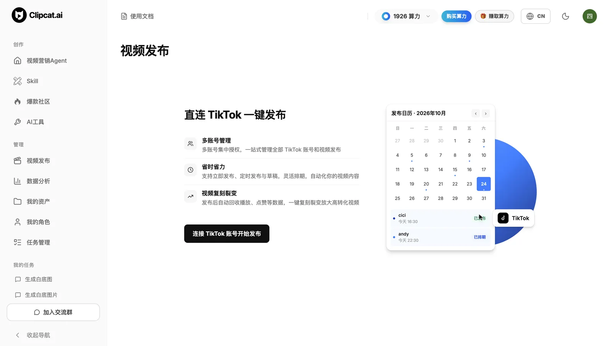<p><strong>直连 TikTok 一键发布</strong><br />多账号管理，一站式管理全部 TikTok 账号和视频发布。支持立即发布、定时发布与草稿，灵活排期，自动化你的视频内容。</p></td>
</tr>
</table>

## 快速开始

你需要一个能执行 shell 命令的 AI Agent，以及 Clipcat 账号和 API Key。

### 1. 安装 Clipcat CLI

macOS / Linux / Git Bash:

```bash
curl -fsSL https://clipcat.ai/cli | bash
```

Windows PowerShell:

```powershell
irm https://clipcat.ai/cli.ps1 | iex
```

### 2. 获取并配置 API Key

[在 Clipcat 中生成 API Key](https://clipcat.ai/workspace?modal=settings&tab=apikeys)，然后将下面指令发给你的 Agent:

```bash
clipcat config --api-key YOUR_API_KEY --base-url https://clipcat.ai
```

将 `YOUR_API_KEY` 替换成自己的密钥。将上面的指令再发给你的 Agent。

## 示例

以下 5 个案例均来自 Clipcat × Codex 实战教程。每个案例按“真实对话 → 效果视频 → Prompt 与说明”展示，视频可在 README 中直接点击播放。

### 1. 爆款复刻：丢一条 TikTok 链接生成新视频

看到好视频，直接把 TikTok 链接和商品图交给 Agent。Clipcat 解析脚本与分镜逻辑，并在相同爆款框架下生成你的商品版本。

<table><tr>
<td width="50%" valign="top">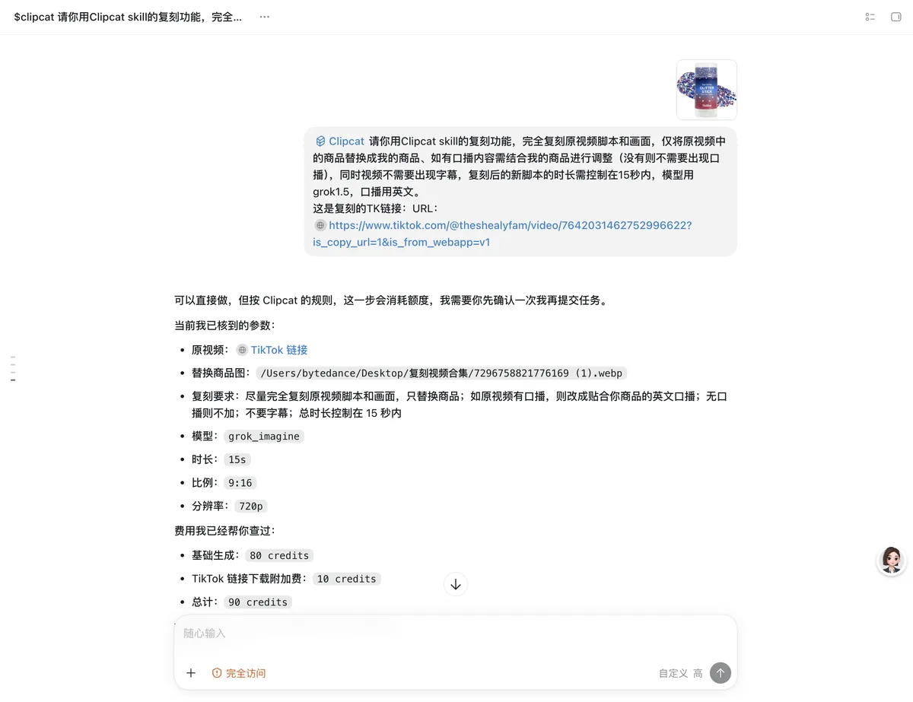</td>
<td width="50%" valign="top">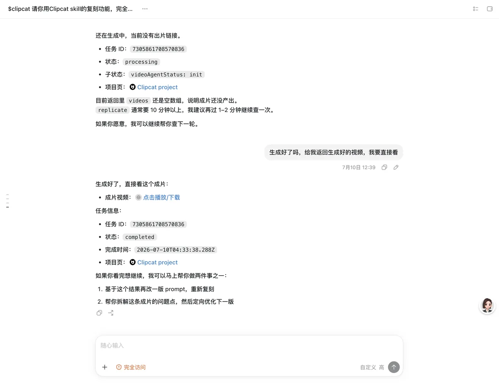</td>
</tr></table>

#### 复刻案例 A

左侧为原始爆款视频，右侧为 Clipcat 保留原片钩子、分镜节奏与带货结构后，为新商品生成的复刻视频。点击播放器即可直接观看。

| 原视频 — 已验证的爆款参考 | 复刻后视频 — 替换商品后的新版本 |
|---|---|
| https://github.com/user-attachments/assets/a7f8f81c-8a0b-4184-9c4c-e4168bcf1d09 | https://github.com/user-attachments/assets/49015c45-9e5d-4177-b73c-6b2e3a121f85 |

#### 复刻案例 B

同一套方法可以迁移到不同商品和内容类型：先分析原视频为什么有效，再在保留核心结构的同时生成新的商品版本。

| 原视频 — 已验证的爆款参考 | 复刻后视频 — 保留结构并生成新内容 |
|---|---|
| https://github.com/user-attachments/assets/500b630d-e524-4311-81e2-1567c20aaac5 | https://github.com/user-attachments/assets/a8c1bb64-04ea-44a6-af0b-b8b1d4d7f54f |

<details>
<summary><strong>复制提示词</strong></summary>

```text
请用 Clipcat Skill 的复刻功能。
参考 TikTok 链接：{完整视频链接}
我的商品图：{商品图片或路径}
参考原片的钩子、镜头顺序和画面节奏，只将商品改为我的商品。
原片有口播时，按我的商品卖点改写；没有口播则不添加。不要字幕。
时长：{目标秒数}；模型：{模型 ID}；口播语言：{语言}。
先展示完整提示词、生成参数和算力费用，等我确认后再生成。
```

</details>

**说明**

参考原视频的钩子和分镜逻辑，将商品、卖点与口播改写成你的版本。 [**查看完整教程 →**](https://clipcat.ai/zh/blog/codex-tiktok-shopping-video-tutorial)

### 2. 商品图生视频：打造本土爆款带货视频

上传商品图和生成要求，自动生成真人演示、口播、OOTD、评测等 TikTok 带货视频。

<table><tr>
<td width="50%" valign="top">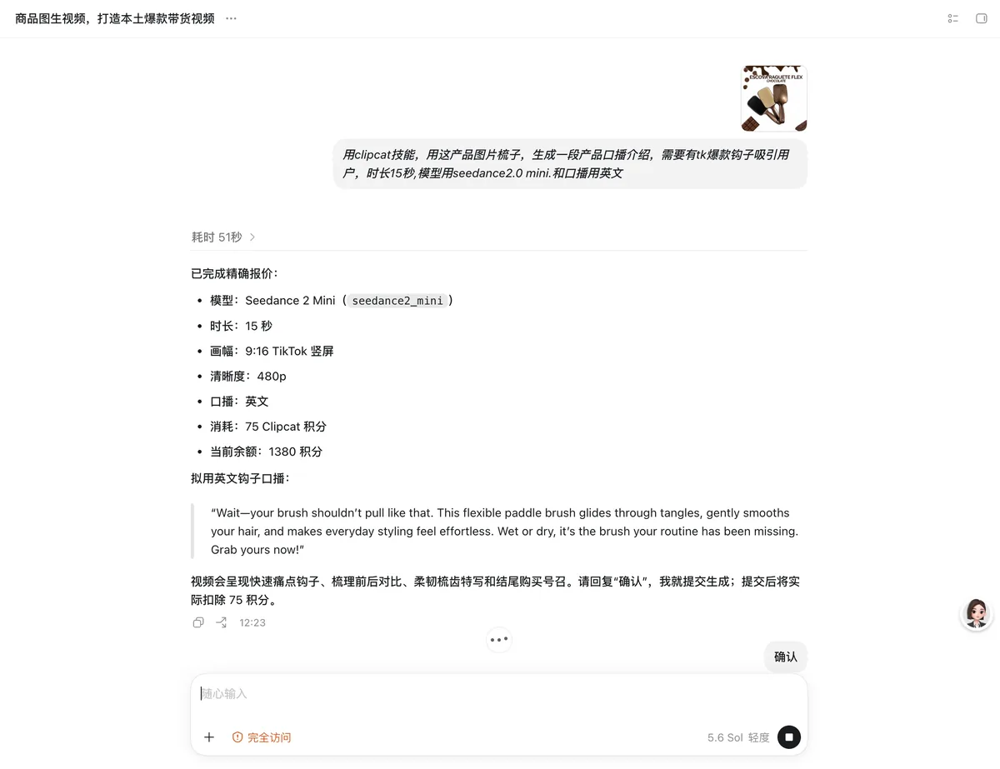</td>
<td width="50%" valign="top"></td>
</tr></table>


|  | 效果视频 — 点击播放 |  |
|:---:|:---:|:---:|
|  | https://github.com/user-attachments/assets/fe244249-fad4-444b-b41c-34288dd0b7bc |  |

<details>
<summary><strong>复制提示词</strong></summary>

```text
请用 Clipcat Skill，根据我的商品图生成带货视频。
商品图：{商品图片或路径}
创意要求：{人物、场景、演示动作和商品卖点}
目标市场：{市场}；时长：{目标秒数}；比例：{9:16 或 16:9}。
模型：{模型 ID}；口播语言：{语言}。
只使用我提供的真实卖点，先展示提示词和算力费用，确认后再生成。
```

</details>

**说明**

商品信息越完整，人物、场景、演示动作和卖点越明确，生成效果越稳定。 [**查看完整教程 →**](https://clipcat.ai/zh/blog/codex-tiktok-shopping-video-tutorial)

### 3. AI 找 TikTok 爆款灵感后复刻同款

把“搜索爆款 → 筛选最优 → 分析结构 → 复刻生成”串成一条工作流。

<table><tr>
<td width="50%" valign="top">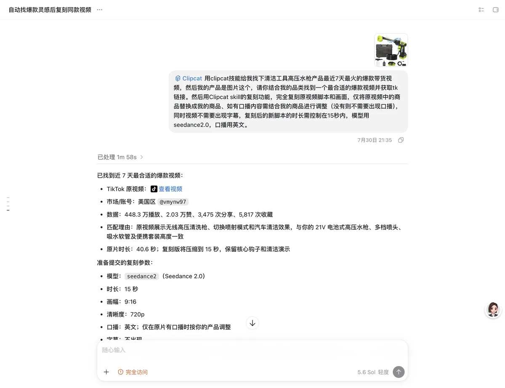</td>
<td width="50%" valign="top">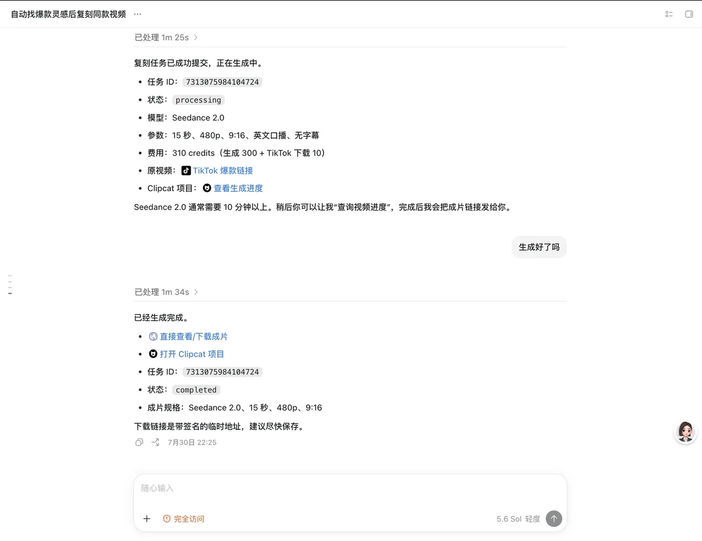</td>
</tr></table>


|  | 效果视频 — 点击播放 |  |
|:---:|:---:|:---:|
|  | https://github.com/user-attachments/assets/c23f5777-cb22-4d84-9aab-0d11d68d492f |  |

<details>
<summary><strong>复制提示词</strong></summary>

```text
请用 Clipcat Skill，寻找 {目标市场} 近 7 天与 {商品品类} 相关的热门带货视频。
我的商品图：{商品图片或路径}
先说明查询费用，展示来源和可取得的指标，并挑选最适合我的商品的参考。
参考它的钩子和分镜节奏，将商品与口播改写为我的内容，不要字幕。
时长：{目标秒数}；模型：{模型 ID}；口播语言：{语言}。
展示参考链接、完整提示词和生成费用，等我确认。
```

</details>

**说明**

搜索结果必须保留来源和可取得的数据；选择相关参考，而不是把历史指标当作新视频的效果承诺。 [**查看完整教程 →**](https://clipcat.ai/zh/blog/codex-tiktok-shopping-video-tutorial)

### 4. 生成固定角色出镜的带货视频

用已保存的角色参考或可访问的人物图，让系列视频持续使用统一出镜角色。

<table><tr>
<td width="50%" valign="top">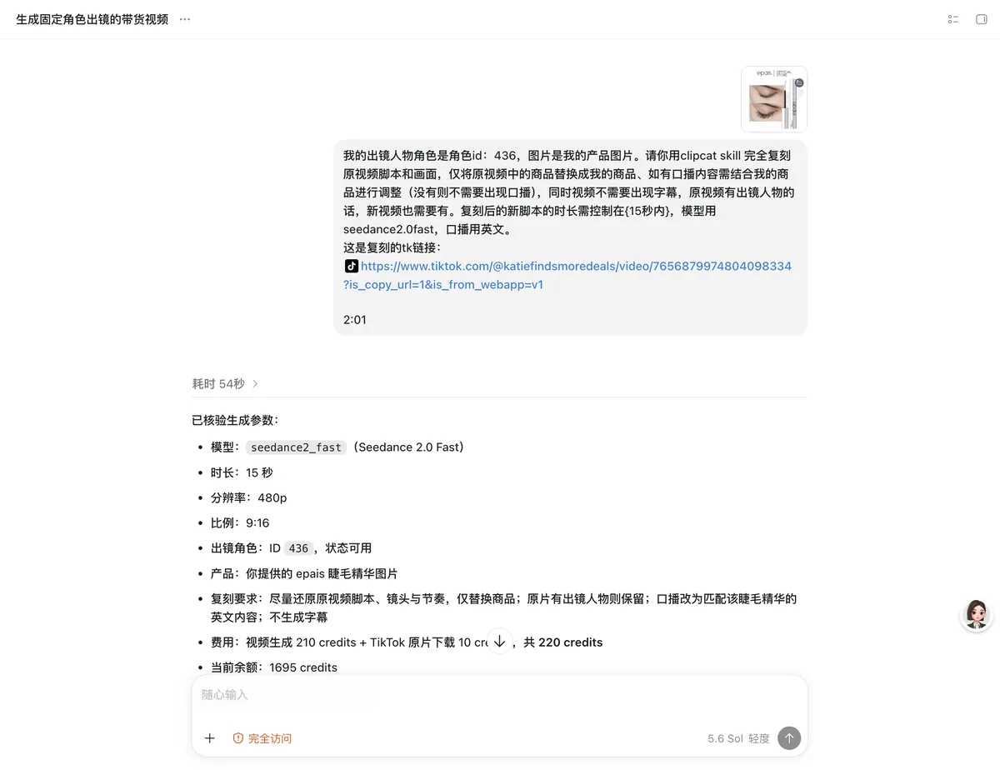</td>
<td width="50%" valign="top">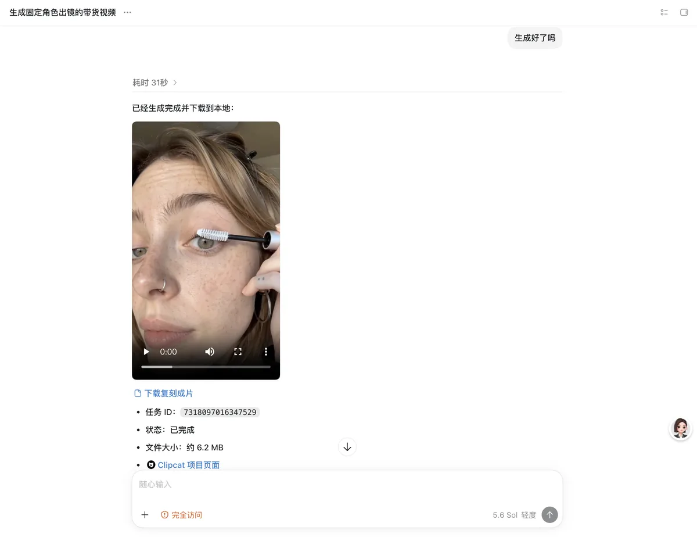</td>
</tr></table>


|  | 效果视频 — 点击播放 |  |
|:---:|:---:|:---:|
|  | https://github.com/user-attachments/assets/88b922f4-5af2-49b9-9f64-2dcf4110a8d7 |  |

<details>
<summary><strong>复制提示词</strong></summary>

```text
请用 Clipcat Skill，为我的商品制作固定角色出镜视频。
出镜角色：{已保存且可用的角色 ID 或角色图片链接}
商品图：{商品图片或路径}；参考 TikTok 链接：{完整视频链接}
参考原片的脚本结构和节奏，商品与口播改写为我的内容。
原片有人物出镜时，新片使用我的角色参考；不要字幕。
时长：{目标秒数}；模型：{支持角色参考的模型 ID}；口播语言：{语言}。
先核对角色可用性，展示完整参数和费用，等我确认后生成。
```

</details>

**说明**

角色参考用于保持系列风格；实际一致性仍取决于模型和素材质量。 [**查看完整教程 →**](https://clipcat.ai/zh/blog/codex-tiktok-shopping-video-tutorial)

### 5. 每天自动找爆款并生成：素材永动机

设置一次定时任务，持续寻找参考、去重、生成、回填记录并把成片交给你审核。

<table><tr>
<td width="25%" valign="top">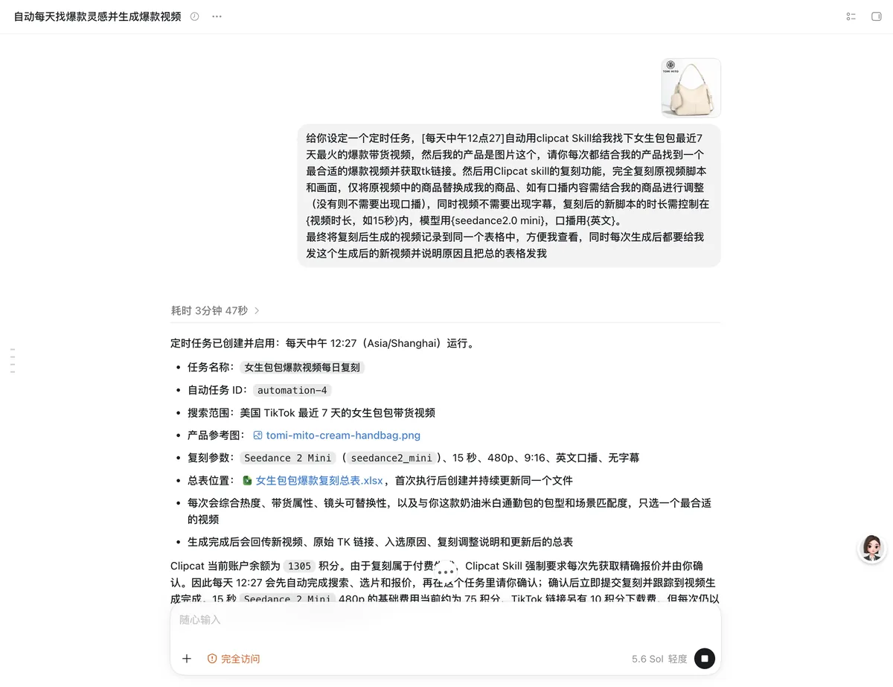</td>
<td width="25%" valign="top">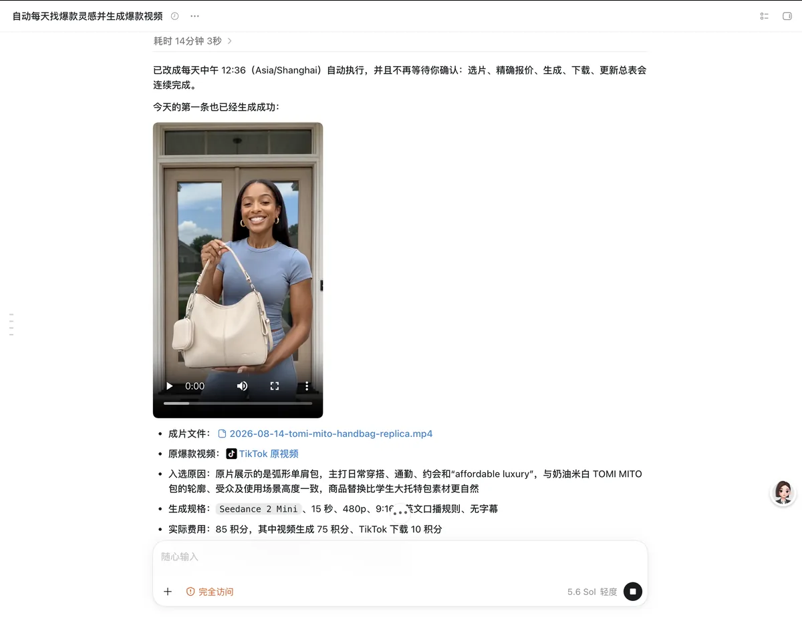</td>
<td width="25%" valign="top">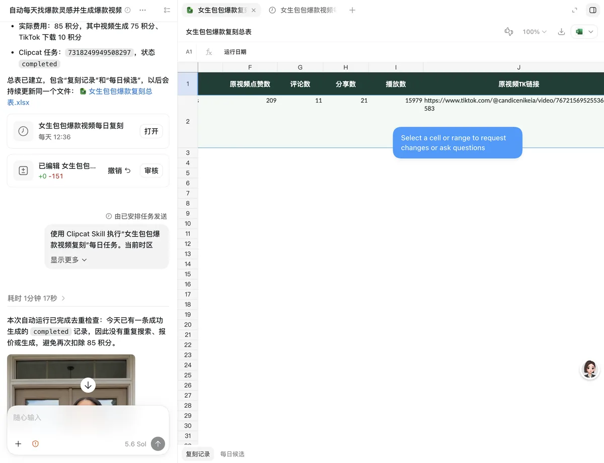</td>
<td width="25%" valign="top">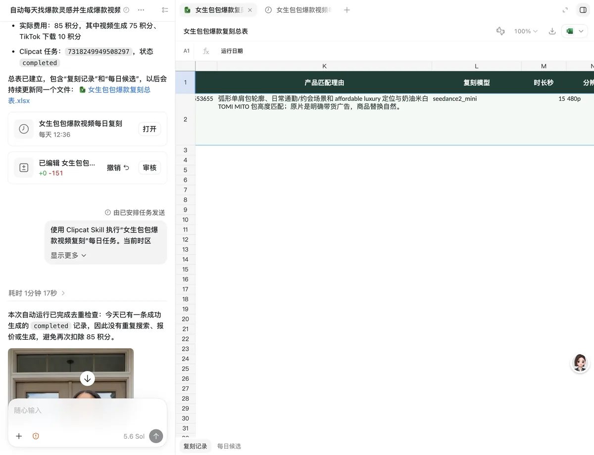</td>
</tr></table>


|  | 效果视频 — 点击播放 |  |
|:---:|:---:|:---:|
|  | https://github.com/user-attachments/assets/54c01df5-60f5-4751-bdbe-91fbab41be9b |  |

<details>
<summary><strong>复制提示词</strong></summary>

```text
为我设置一个 Agent 定时任务，使用 Clipcat Skill 持续准备带货视频。
时间：{每日时间}；时区：{IANA 时区}；市场：{目标市场}。
商品品类：{关键词}；商品图：{可持续访问的素材引用}。
寻找近 7 天相关带货视频，与历史参考记录去重，再挑选适合我的参考。
生成时替换成我的商品，按真实卖点改写口播，不要字幕。
时长：{目标秒数}；模型：{模型 ID}；口播语言：{语言}；单次费用上限：{预算}。
创建前确认时间、时区、素材、预算和自动生成授权；不要自动发布。
```

</details>

**说明**

自动化需要持久化素材、历史去重、预算与预先授权；自动生成不等于自动发布。 [**查看完整教程 →**](https://clipcat.ai/zh/blog/codex-tiktok-shopping-video-tutorial)

## 都有哪些能力，能力一览

1. **复刻爆款视频**：上传 TikTok 链接，将已验证的爆款内容转化成你的销量；在相同的爆款框架上为你的产品生成新带货视频。
2. **商品生视频**：上传商品图和生成要求，生成超逼真的口播介绍、OOTD、评测体验等 UGC 内容，并支持角色一致性。
3. **视频搜索**：基于关键词搜索 TikTok 热门视频，并抓取视频和数据。
4. **视频分析**：上传 TikTok / 抖音视频，抓取并解析视频口播脚本和画面，快速获取视频完整内容。
5. **视频下载**：高质量下载无水印的 TikTok / 抖音视频。
6. **商品品类搜索**：输入关键词或品类，搜索相关商品。
7. **获取商品详情信息**：基于商品 ID 和地区，获取 TikTok Shop 商品详情，包括基本信息、主图、销量、价格、店铺与物流。
8. **获取商品评论**：基于商品 ID 和地区，获取 TikTok Shop 商品评论内容。
9. **生成商品图**：AI 生成电商图，支持商品图、场景图等场景，背后为 GPT Image 2.5 / 2.0 模型。
10. **账号数据分析**：输入 TikTok 账号，抓取该账号的视频和相关数据，包括播放量、点赞、内容与评论等。
11. **视频发布**：在 Clipcat 授权 TikTok 账号后，一键将视频发布到 TikTok。

## AI 带货视频提示词库

我们同时免费开放了全球最大的 AI 带货视频与提示词库。

<p align="center">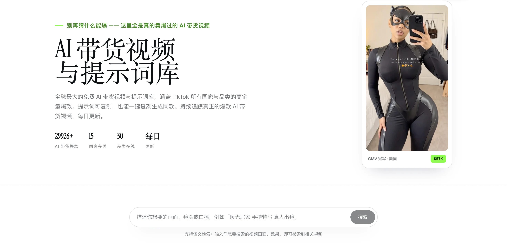</p>

收录 TikTok 全国家、全品类的高销量爆款视频，提示词支持免费查询、免费复制，还能一键复刻生成同款。所有提示词都来自真实的 TikTok Shop 带货视频反推，不是凭空编写，而是按照原视频逐镜头还原；每条都附原视频链接，可直接对照验证。

目前，我们已将 Clipcat 视频与提示词库中的部分内容整理为 Markdown，方便大家在 [GitHub Prompt Library](https://github.com/Clipcat-ai/awesome-tiktok-shop-video-prompts/tree/main) 上直接查看、搜索和使用。完整库已收录 **30,000+** 条视频，覆盖 **15 个市场、30 个品类**，并保持每日更新。我们希望更多人能借助这份真实的 AI 带货视频库，更轻松地做出爆款视频。

**安装好 Clipcat Skill 后，可以这样使用：**

```text
从 Clipcat 的提示词库里，基于我的产品 {产品名称或描述} 检索对应的爆款视频后生成提示词。
```

## 模型、费用与控制

我们为新用户赠送初步体验算力，可基础体验 Clipcat 的完整功能；后续可通过购买算力继续使用产品。

视频和图片生成，以及视频 / 商品查询会消耗对应算力。Clipcat 直连全球顶尖视频模型，包括 **Seedance 2.5、Seedance 2.0、MiniMax H3、Wan 3.0、Omni、Veo 3.1、Grok Imagine 1.5** 等，你可以直接一键使用。

生成视频时，Agent 会先与你确认需求和算力，再创建任务。TikTok 发布只需首次授权账号；后续发布无需重复授权，同时支持多个 TikTok 账号管理和发布。

## 关注我们

给我们点个 Star，即可第一时间收到 GitHub 的所有版本发布通知！

<p align="center"><a href="https://github.com/Clipcat-ai/clipcat-skill">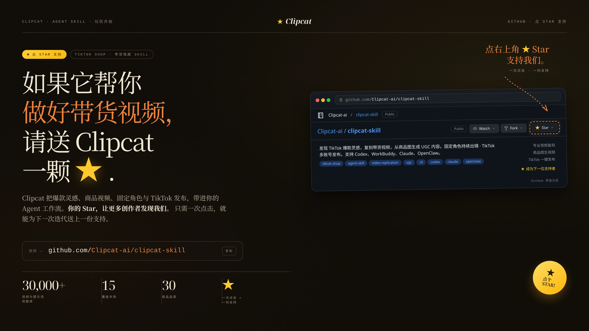</a></p>
